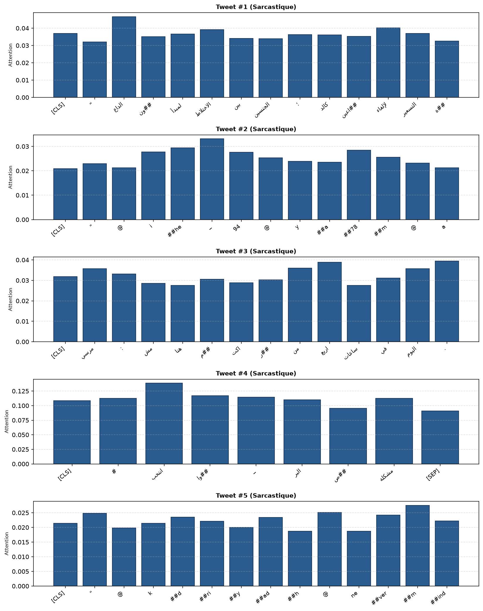

# 🎭 Détection du Sarcasme en Arabe — ArSarcasm-v2

[](https://www.python.org/)
[](https://pytorch.org/)
[](https://huggingface.co/)
[](https://github.com/iabufarha/ArSarcasm-v2)
[](LICENSE)

Ce dépôt présente une étude empirique approfondie de la **détection automatique du sarcasme dans les tweets arabes dialectaux** sur le benchmark international **ArSarcasm-v2** (WANLP 2021). 

Le projet compare **21 configurations expérimentales**, couvrant les modèles statistiques lexicaux (TF-IDF avec études d'ablation), le transfert Zero-Shot NLI multilingue, l'extraction de représentations gelées (Mean Pooling vs CLS), l'apprentissage multi-tâche (sarcasme + sentiment), et le fine-tuning complet de modèles de langue pré-entraînés (**AraBERT-twitter** et **MARBERTv2**).

---

## 👥 Auteurs & Encadrement

* **Étudiants :** Amine Bouaouda & Mohammed El Amrani
* **Filière :** Master Big Data & IoT — Module *Transformers & LLMs*
* **Encadrant :** Prof. Yassir Matrane
* **Date :** Octobre 2026

---

## 🏆 Résultats Clés & Leaderboard

Le sarcasme étant une classe rare (~17% du corpus), la métrique officielle de référence est le **F1-Score sur la classe sarcastique** ($F_1$), complété par le **PR-AUC** (robuste aux déséquilibres) et le **Macro-F1**.

| Rang | Modèle / Approche | Famille | Split | $F_1$ Sarc. | PR-AUC | Macro-$F_1$ | Seuil optimal |
| :---: | :--- | :---: | :---: | :---: | :---: | :---: | :---: |
| 🥇 | **UBC-NLP/MARBERTv2 Fine-Tuned** | E1 | val | **0.6535** | 0.6480 | **0.7812** | 0.30 |
| 🥈 | **AraBERTv02-twitter Fine-Tuned** | E1 | val | **0.6417** | **0.6794** | 0.7725 | 0.20 |
| 🥉 | **AraBERT Gelé (Moyenne Masquée) + LR** | D1 | val | **0.6180** | 0.6264 | 0.7510 | 0.50 |
| 4 | **AraBERT Gelé [CLS] + LR** | D1 | val | 0.5872 | 0.5545 | 0.7360 | 0.50 |
| 5 | **AraBERT Multi-Tâche ($\lambda = 0.5$)** | E2 | val | 0.5638 | 0.5833 | 0.7280 | 0.30 |
| 6 | **AraBERT Multi-Tâche ($\lambda = 1.0$)** | E2 | val | 0.5455 | 0.5259 | 0.7140 | 0.25 |
| 7 | **TF-IDF Caractères (2-5 grammes)** | A | val | 0.5361 | 0.5161 | 0.7066 | 0.50 |
| 8 | **AraBERT Multi-Tâche ($\lambda = 0.3$)** | E2 | val | 0.5241 | 0.5162 | 0.7015 | 0.30 |
| 9 | **TF-IDF Mots (1-2 grammes)** | A | val | 0.4755 | 0.4481 | 0.6604 | 0.48 |
| 10 | **Heuristique Sentiment CAMeL-Lab** | B2 | val | 0.4700 | 0.4200 | 0.6350 | 0.50 |
| 11 | **TF-IDF sans indices (Ablation)** | A | val | 0.4653 | 0.4216 | 0.6530 | 0.48 |
| 12 | **Zero-Shot NLI Français (mDeBERTa-v3)** | B1 | val | 0.4110 | 0.3810 | 0.6150 | 0.85 |
| 13 | **TF-IDF Sur-échantillonnage** | A | val | 0.4088 | 0.4089 | 0.6465 | 0.50 |
| 14 | **Zero-Shot NLI Anglais (mDeBERTa-v3)** | B1 | val | 0.3980 | 0.3720 | 0.6080 | 0.85 |
| 15 | **Zero-Shot NLI Arabe (mDeBERTa-v3)** | B1 | val | 0.3762 | 0.3650 | 0.5920 | 0.55 |
| 16 | **Raccourcis seuls (Présence d'URL)** | A | val | 0.3685 | 0.3239 | 0.5074 | 0.50 |
| 17 | **TF-IDF Baseline (Test Officiel)** | F | test | **0.5003** | 0.4642 | 0.6283 | 0.50 |

---

## 🔍 Enseignements Méthodologiques Majeurs

### 1. Le Piège du Prior Shift (+10.1 pp)
* **Train / Val :** 17.28% de sarcasme.
* **Test Officiel :** 27.37% de sarcasme (+10.1 pp de prévalence).
* **Conséquence :** Conserver le seuil fixe par défaut ($\tau = 0.50$) sur le test entraîne une sous-détection massive (hausse des faux négatifs). Un ajustement dynamique du seuil vers $\tau \in [0.30, 0.35]$ via recalibration bayésienne (Platt Scaling) est indispensable en production.

### 2. Audit des Raccourcis Superficiels (*Shortcut Learning*)
* **Absence d'URL ($r = -0.219$) :** Les tweets sérieux partagent des liens web ; les tweets sarcastiques en sont presque dépourvus. La simple règle heuristique `Pas d'URL -> Sarcastique` atteint un $F_1 = 0.476$ sans NLP !
* **Guillemets initiaux (`"`) :** Présents dans 60.9% du train mais 0.8% du test (artefact de format CSV).

### 3. Modèles Gelés : Moyenne Masquée vs `[CLS]` (+3.1 pts F1)
En gelant les poids d'AraBERT, faire la **moyenne masquée des tokens réels** ($F_1 = 0.6180$) surpasse nettement le premier token `[CLS]` ($F_1 = 0.5872$). La moyenne masquée agrège les marqueurs d'exagération et emojis situés à la chute du tweet.

### 4. Apprentissage Multi-Tâche Sarcasme + Sentiment
Avec la perte jointe $\mathcal{L} = \mathcal{L}_{\text{sarc}} + \lambda \mathcal{L}_{\text{sent}}$, l'apprentissage conjoint converge vers un optimum net à **$\lambda = 0.5$** ($F_1 = 0.5638$). À $\lambda = 1.0$, un phénomène de *transfert négatif* apparaît : la classification du sentiment parasite la détection fine du sarcasme.

---

## 📊 Interprétabilité : Ce que regarde le Modèle

Grâce au mécanisme d'attention sur les représentations de tokens gelées (Partie D2), nous visualisons les zones d'activation décisionnelles :



* **Pics d'attention (> 0.25) :** Mots de négation, adverbes d'exagération et entités nommées cibles de l'ironie.
* **Attention minimale (< 0.05) :** Mots vides et prépositions ordinaires (`في`, `من`, `على`).

---

## 📁 Structure du Projet

```text
├── notebooks/                              # Notebooks Jupyter par partie (exécutés avec outputs)
│   ├── TP2_Partie_A.ipynb                  # Exploration, Audit des raccourcis & TF-IDF
│   ├── TP2_Partie_B.ipynb                  # Zero-Shot NLI (mDeBERTa) & Sentiment (CAMeL-Lab)
│   ├── TP2_Partie_C.ipynb                  # Réseaux de neurones caractères (BiLSTM, Transformer)
│   ├── TP2_Partie_D.ipynb                  # PLM Gelé (CLS vs Moyenne) & Attention D2
│   ├── TP2_Partie_E.ipynb                  # Fine-Tuning Mono-tâche & Multi-tâche (GPU FP16)
│   ├── TP2_Partie_F.ipynb                  # Généralisation, Prior shift & Test officiel
│   └── TP2_Partie_G.ipynb                  # Matrice de confusion finale & Décision
├── results/                                # Résultats consolidés et graphiques
│   ├── results.csv                         # Tableau récapitulatif des 21 modèles
│   ├── partie_A_results.csv ... partie_F   # CSVs individuels par partie
│   └── attention_d2.png                    # Graphique des poids d'attention (5 tweets)
├── predictions/                            # Fichiers de prédictions sur le test officiel
│   └── partie_F_seed42.csv                 # 3 000 prédictions officielles du test
├── src/                                    # Code Python modulaire et réutilisable
│   ├── data/dataset.py                     # Chargement et séparation stratifiée
│   ├── preprocess/text.py                  # Pipeline de nettoyage et normalisation
│   ├── models/metrics.py                   # Calcul F1, PR-AUC, Macro-F1 et seuils
│   └── train/reproducibility.py            # Fixation des graines aléatoires (seed 42)
├── Compte_Rendu_TP2_Bouaouda.pdf           # Rapport écrit officiel complet (PDF A4)
├── Presentation_TP2_Sarcasme_Bouaouda.pdf  # Diaporama de soutenance (Format 16:9 Widescreen)
├── Presentation_TP2_Sarcasme_Bouaouda.pptx # Présentation PowerPoint éditable
├── requirements.txt                        # Dépendances logicielles
└── README.md                               # Documentation du projet
```

---

## 🚀 Installation & Exécution

### 1. Cloner le dépôt
```bash
git clone https://github.com/<votre-nom-utilisateur>/<nom-du-repo>.git
cd <nom-du-repo>
```

### 2. Créer l'environnement virtuel & Installer les dépendances
```bash
# Création de l'environnement virtuel
python -m venv .venv
source .venv/bin/activate        # Sur Linux / macOS
# .venv\Scripts\Activate.ps1     # Sur Windows PowerShell

# Installation des dépendances avec support GPU CUDA
pip install --upgrade pip
pip install -r requirements.txt
```

### 3. Exécuter les Notebooks
Lancez Jupyter Lab ou VS Code :
```bash
jupyter lab
```
Ouvrez les notebooks dans `notebooks/` dans l'ordre de `A` à `G` en sélectionnant le kernel Python correspondant.

---

## 🛠️ Stack Technique

* **Frameworks :** PyTorch 2.1 (FP16 AMP avec `torch.cuda.amp`), Hugging Face `transformers`, `scikit-learn`.
* **Modèles Pré-entraînés :**
  * `UBC-NLP/MARBERTv2` (163M paramètres, pré-entraîné sur 1 Milliard de tweets dialectaux).
  * `aubmindlab/bert-base-arabertv02-twitter` (135M paramètres).
  * `MoritzLaurer/mDeBERTa-v3-base-xnli-multilingual-nli-2mil7`.
  * `CAMeL-Lab/bert-base-arabic-camelbert-da-sentiment`.
* **Rapports & Slides :** `fpdf2`, `python-pptx`, `matplotlib`, `seaborn`.

---

## 📜 Citation

Si vous utilisez ce travail ou ce benchmark, veuillez citer le corpus original :
```bibtex
@inproceedings{abufarha-etal-2021-overview,
    title = "Overview of the {WANLP} 2021 Shared Task on Sarcasm and Sentiment Detection in {A}rabic",
    author = "Abu Farha, Ibrahim and Zaghouani, Wajdi and Camacho-collados, Jose",
    booktitle = "Proceedings of the Sixth Arabic Natural Language Processing Workshop",
    year = "2021",
    publisher = "Association for Computational Linguistics"
}
```

---

## 📄 Licence
Ce projet est sous licence MIT — voir le fichier [LICENSE](LICENSE) pour plus de détails.
